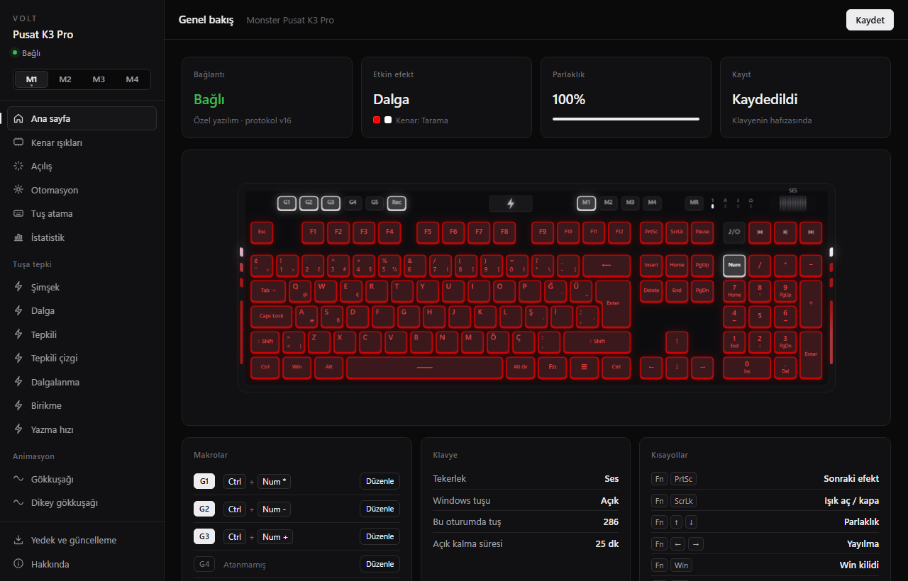
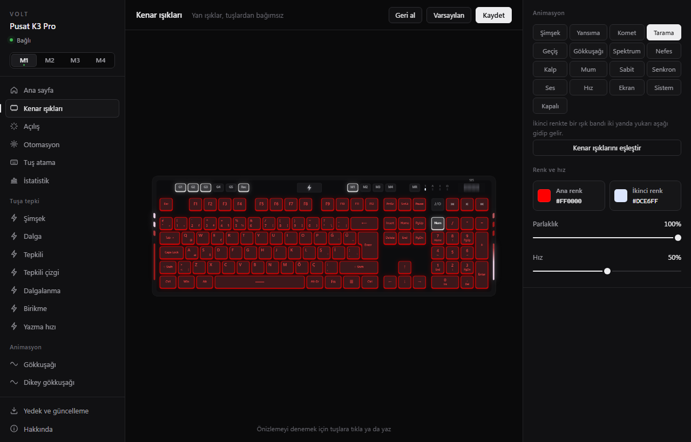
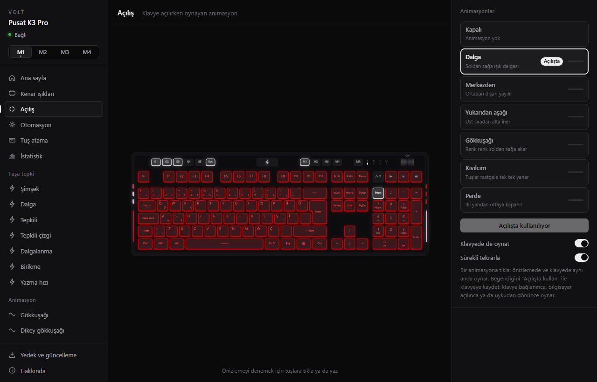
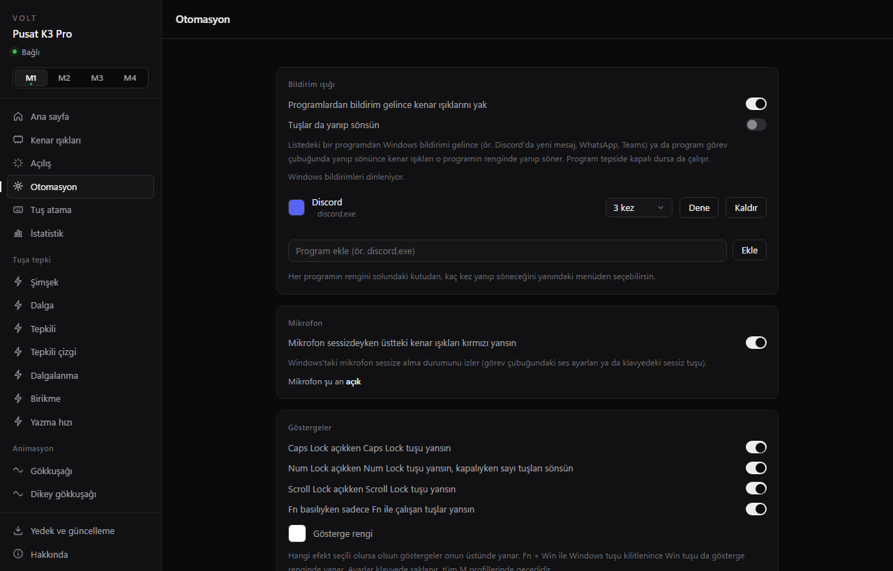
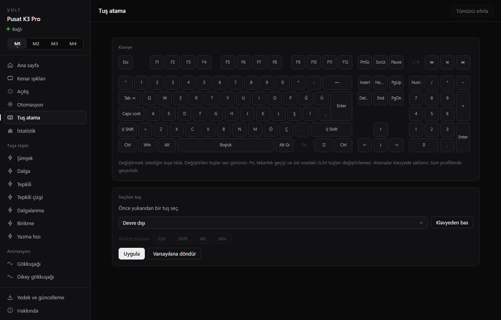

# Volt — Monster Pusat K3 Pro için açık kaynak yazılım

Monster Pusat K3 Pro klavye için QMK tabanlı özel klavye yazılımı (firmware) ve Windows ayar uygulaması **Volt**.

> ⚠️ **Resmi değildir.** Bu proje Monster Notebook ile bağlantılı değildir, onlar tarafından desteklenmez.
> Monster ve Pusat, sahiplerinin ticari markalarıdır.
>
> ⚠️ **Sorumluluk sende.** Klavyeye yazılım yüklemek garantiyi bozabilir ve yanlış yapılırsa klavyeyi
> kullanılamaz hâle getirebilir. Yazılım "olduğu gibi" sunulur, hiçbir garanti verilmez (bkz. [Lisans](#lisans)).
> Başlamadan önce **Orijinal yazılıma dönüş** bölümünü oku.



| Kenar ışıkları | Açılış animasyonu |
|---|---|
|  |  |
| **Otomasyon** | **Tuş atama** |
|  |  |

## Özellikler

- 18 tuş efekti (Şimşek, Dalga, Tepkili, Gökkuşağı, Spektrum…) ve renk, parlaklık, hız ayarları
- **Ses modu**: Windows'ta çalan sese göre spektrum, nabız, dalga veya renk (mikrofon kullanılmaz; Volt açık olmalı)
- **Ekran rengi**: ekrandaki renkler klavyeye yansır (ambilight)
- **Tuş boyama**: her tuşa kendi rengini ver; her M profilinin kendi boyaması
- **Yazma hızı**: hızlandıkça renk değişir; kenar ışıkları gösterge olabilir
- **Otomasyon**: Discord, WhatsApp, Teams gibi programlardan Windows bildirimi gelince kenar ışıkları her programın kendi renginde yanıp söner (program tepsideyken de), mikrofon sessizdeyken kırmızı yanar, programa göre M1–M4 otomatik seçilir
- **Tuş atama**: herhangi bir tuşu başka bir tuşa, kısayola (ör. Ctrl + C) ya da medya tuşuna çevir; klavyede saklanır
- **Açılış animasyonu**: klavye bağlanınca, bilgisayar açılınca ya da uykudan dönünce oynar; 6 stil (dalga, merkezden, yukarıdan aşağı, gökkuşağı, kıvılcım, perde); Açılış sayfasında her biri önizleme klavyesinde canlı izlenir, klavyede de oynatılabilir
- **Sistem göstergesi**: kenar ışıkları CPU, RAM ya da ekran kartı kullanımını gösterir; yük arttıkça yeşilden kırmızıya döner
- **Tuş istatistiği**: ısı haritası, günlük tuş sayısı ve en çok basılan tuşlar (sadece sayılar tutulur, yazılanlar asla kaydedilmez)
- **Güncelleme denetimi**: Volt'un yeni sürümü GitHub'da yayınlanınca haber verir
- Kenar ışıkları için 14 ayrı animasyon, tuşlardan bağımsız renk ve hız
- Gerçek klavyeyle eşzamanlı canlı önizleme
- M1–M4 profilleri; MR ile son değişikliği geri alma
- G1–G5 makroları: klavyedeki **Rec** tuşuyla kayıt (kayıt sırasında tuşlar bilgisayara gitmez)
- Makro düzenleyici: G tuşu makrolarını uygulamadan düzenleme, bekleme ekleme
- Yedekleme ve profil paylaşma (`Belgeler\Volt` klasörüne)
- Klavye yazılımını uygulamadan güncelleme (ayarlar otomatik yedeklenip geri yüklenir)
- Sistem tepsisinde çalışma ve Windows ile başlama
- Ayarlar klavyenin kendi hafızasında saklanır; Volt kapalıyken de çalışır

## Desteklenen cihaz

| | |
|---|---|
| Klavye | Monster Pusat K3 Pro (tam boy, Türkçe Q) |
| Çip | Sonix SN32F248B |
| Orijinal USB kimliği | `0C45:5004` |
| Bu yazılımla USB kimliği | `0C45:5104` |

Başka bir klavyeye **yükleme**. Farklı donanımda çalışmaz.

## Kurulum

Gerekenler: Windows 10/11 (WebView2 yüklü gelir). Ek bir araç gerekmez.

1. Releases sayfasından `Volt_Kurulum.exe`yi indir ve çalıştır. Volt sadece senin kullanıcı hesabına kurulur,
   yönetici izni istemez; Başlat menüsüne (istersen masaüstüne) kısayol ekler.
2. Monster'ın uygulaması açıksa tamamen kapat (tepsi simgesi → Çıkış).
3. Volt'u aç. Klavyede orijinal Monster yazılımı varsa Volt bunu fark eder, özellikleri kilitler ve
   **Volt yazılımına geç** düğmesini gösterir. Geçiş yaklaşık 15 saniye sürer, klavyeyi açman gerekmez.

Klavye yazılımı güncellemeleri de Volt'un **Yedek ve güncelleme** sayfasından tek tıkla yapılır.
Her yükleme klavyedeki ayarları sıfırlar; Volt önce profilleri ve makroları yedekler, sonra geri yükler.

## Orijinal yazılıma dönüş

**Yedek ve güncelleme → Orijinal yazılıma dön.** Volt, orijinal yazılımı Monster'ın kendi destek sitesindeki
herkese açık sürücü paketinden (`pusatk3driver.zip`) indirir, içindeki `Upgrade Package.exe`den çıkarır
(exe çalıştırılmaz, sadece okunur), parmak izini bilinen sürümle (v1.00, 2021-12-28) karşılaştırır ve klavyeye yükler.
Orijinal yazılım bu projeyle dağıtılmaz. İnternet yoksa paketi kendin indirip **İndirilenler** klasörüne koyman yeterli.

Volt'u kaldırırken (**Yedek ve güncelleme → Volt'u kaldır** ya da Windows **Ayarlar → Uygulamalar**) klavyeyi
orijinal yazılıma döndürmeyi de seçebilirsin.

En kötü durumda (yükleme yarıda kesildi ve klavye güncelleme moduna girmiyor) çipin silinemeyen ROM yükleyicisi
sayesinde klavye kurtarılabilir, ama bunun için klavyeyi açıp karttaki BOOT noktasını kullanmak gerekir.

## Derleme

### Volt (Rust)

```powershell
cargo build --release --bin pusat_isik
cargo build --release --bin volt_kurulum
```

Çıktılar: `target\release\pusat_isik.exe` (Volt) ve `target\release\volt_kurulum.exe` (içinde Volt olan kurulum programı; önce Volt derlenmeli).
Simge ve sürüm bilgisi `build.rs` ile, Windows SDK'daki `rc.exe` kullanılarak exe'lere gömülür (SDK yoksa simgesiz derlenir).

### Klavye yazılımı (SonixQMK, WSL/Linux)

1. [SonixQMK](https://github.com/SonixQMK/qmk_firmware) deposunu `sn32_master` dalıyla kur ve QMK ortamını hazırla.
2. `qmk/keyboards/pusat` klasörünü SonixQMK'nin `keyboards/` klasörüne kopyala.
3. LED sürücüsü yamasını uygula:

   ```bash
   python3 qmk/patch_driver.py ~/sonixqmk/drivers/led/sn32/rgb_matrix_sn32f24xb.c
   ```

4. Derle: `make pusat/k3pro:simsek` → `pusat_k3pro_simsek.bin`.

Belgeler: [PROTOKOL.md](PROTOKOL.md) (orijinal yazılımın USB ışık protokolü), [DONANIM_HARITASI.md](DONANIM_HARITASI.md) (tuş matrisi ve LED pinleri).

## Lisans

© 2026 [Eresbos](https://github.com/ERESB0S)


- **Klavye yazılımı** (`qmk/`): GPL-2.0-or-later; [QMK](https://github.com/qmk/qmk_firmware) ve [SonixQMK](https://github.com/SonixQMK/qmk_firmware) üzerine kuruludur.
- **Volt uygulaması** (`src/`, `scripts/`): GPL-3.0-or-later. Bkz. [LICENSE](LICENSE).

Kullanılan kütüphaneler: wry / tao (MIT / Apache-2.0), hidapi (MIT), windows (MIT / Apache-2.0), sha2 (MIT / Apache-2.0), anyhow (MIT / Apache-2.0), Microsoft WebView2.
Yazı tipi: [Poppins](https://github.com/itfoundry/Poppins) (SIL Open Font License 1.1, bkz. [yazi/OFL.txt](yazi/OFL.txt)).
